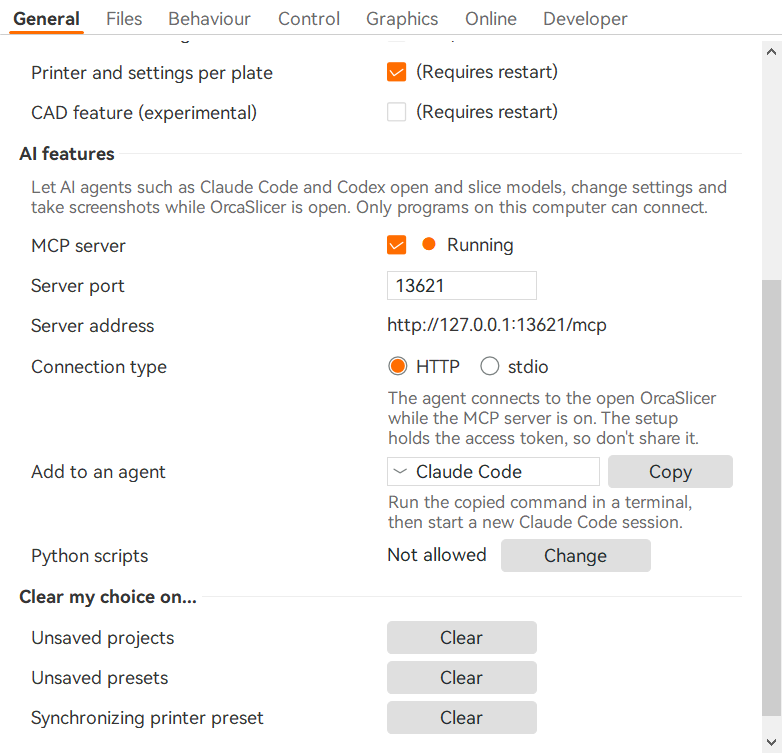
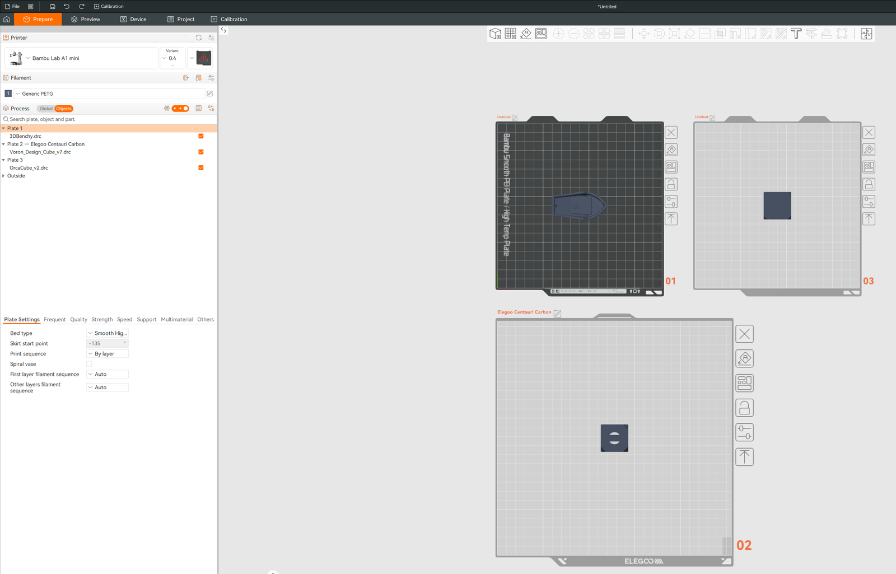
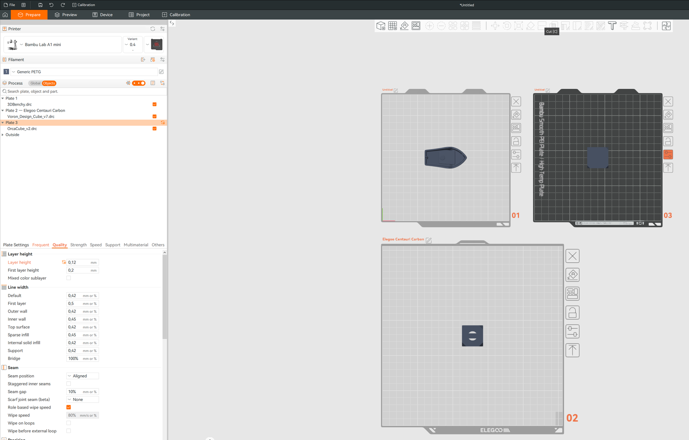
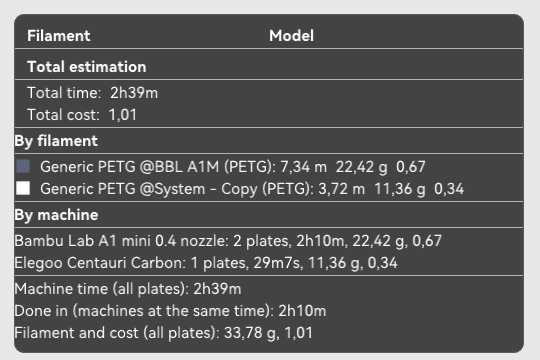

## English

**This is not the official OrcaSlicer.** It is a test build of a fork of
OrcaSlicer where each plate of a project can have its own printer, process,
filaments, plate settings and physical machine: several printers in one
project, one row of plates per machine. The concept is inspired by the
multiple beds of PrusaSlicer 3.0.

This is a test phase: expect bugs, and keep backups of your projects.

- The app is **orange with a red logo on purpose**, so it is not mistaken for
  the official OrcaSlicer.
- It includes an **MCP server**, which lets AI assistants drive OrcaSlicer.
  Start it with `--mcp` (optional `--mcp-port <port>`).
- No printer, filament or process profiles of anyone are included beyond
  OrcaSlicer's standard system profiles: import or create your own.

### Turn it on

The feature is off by default, so the app works like the official OrcaSlicer
until you turn it on: **Preferences > General > Features > "Printer and
settings per plate"**, then restart. The MCP server is in the same tab, under
**AI features**.

### Features

**Several printers in one project.** Select a plate and choose a printer,
process and filaments: only that plate changes. Plates of the same printer sit
side by side, and each printer gets its own row. Each plate shows its own bed
(shape, size and 3D model); plates other than the selected one are drawn in
light grey. Below: plates 1 and 3 on a Bambu Lab A1 mini, plate 2 on an Elegoo
Centauri Carbon.

**Settings per plate.** Any process setting can be changed for one plate.
Settings apply in three levels: project, then plate, then object. A plate with
its own settings shows the settings icon in orange, in the 3D view and in the
object list. Below: plate 3 prints at 0.12 mm layers, the other plates at
0.2 mm.

**Copy and paste plates.** Right-click a plate: **Copy plate settings**,
**Paste plate settings** (everything, printer included) and **Paste
special...** (choose what to paste). A new plate starts with the settings of
the selected one.

**Physical machine per plate.** Useful with several machines of the same
model (for example two H2C with different filaments loaded). A plate is bound
to your machine automatically when you have only one of that model, or with
right-click **Choose machine...**. The machine's name is shown on the plate.
Before printing or syncing filaments, OrcaSlicer switches to the plate's
machine. **Print all** sends each plate to its own machine, after one
confirmation list.

**Slice all and statistics for all plates.** "Slice all" slices each plate
with its own printer. **All Plates Stats** adds up filament, cost and time by
filament and by machine, and shows how long the job takes with the machines
working at the same time.

**Moving objects between plates.** An object moved to a plate with other
filaments takes the closest one (same material first, then the nearest
colour), and a notification says what changed.

**Project files.** The plates' printers are saved in the 3MF. The official
OrcaSlicer still opens the file, with every object on its plate and plate 1's
printer for all of them.

**Not done yet:** undo (Ctrl+Z) of printer changes; the machine features need
more testing with real printers.

### Downloads

- **Windows x64: portable zip only** (no installer). Unzip it and run
  `orca-slicer.exe`. It keeps its own settings in the `data_dir` folder next to
  the program, separate from an installed OrcaSlicer.
- **Linux x86_64: AppImage.** It uses the same settings folder as an installed
  OrcaSlicer (`~/.config/OrcaSlicer`); to keep them apart, start it with
  `--datadir <folder>`.
- **macOS:** no build; build it from source.

**Problems:** please report them in this fork's GitHub
[issues](https://github.com/3devangelist/OrcaSlicer/issues), not to the official OrcaSlicer.

## Português (PT-PT)

**Esta não é a versão oficial do OrcaSlicer.** É uma versão de testes de um
fork do OrcaSlicer em que cada placa de um projeto pode ter a sua própria
impressora, processo, filamentos, definições de placa e máquina física: várias
impressoras num só projeto, uma fila de placas por máquina. A ideia inspira-se
nas várias bases de impressão (multiple beds) do PrusaSlicer 3.0.

Está em fase de testes: conte com erros e guarde cópias de segurança dos seus
projetos.

- A aplicação é **cor de laranja com o logótipo vermelho de propósito**, para
  não ser confundida com o OrcaSlicer oficial.
- Inclui um **servidor MCP**, que permite a assistentes de IA comandar o
  OrcaSlicer. Arranca com `--mcp` (opcional: `--mcp-port <porta>`).
- Não traz perfis de impressora, filamento ou processo de ninguém além dos
  perfis de sistema normais do OrcaSlicer: importe ou crie os seus.

### Como ligar

A funcionalidade vem desligada, por isso o programa funciona como o OrcaSlicer
oficial até a ligar: **Preferences > General > Features > "Printer and
settings per plate"** e reinicie. O servidor MCP está no mesmo separador, em
**AI features**.

### Funcionalidades

**Várias impressoras num só projeto.** Selecione uma placa e escolha a
impressora, o processo e os filamentos: só essa placa muda. As placas da mesma
impressora ficam lado a lado e cada impressora tem a sua fila. Cada placa
mostra a sua base (forma, tamanho e modelo 3D); as placas que não estão
selecionadas aparecem a cinzento-claro. Na imagem: placas 1 e 3 numa Bambu Lab
A1 mini, placa 2 numa Elegoo Centauri Carbon.

**Definições por placa.** Qualquer definição de processo pode ser alterada só
numa placa. As definições aplicam-se em três níveis: projeto, depois placa,
depois objeto. Uma placa com definições próprias mostra o ícone de definições
a laranja, na vista 3D e na lista de objetos. Na imagem: a placa 3 imprime com
camadas de 0,12 mm, as outras com 0,2 mm.

**Copiar e colar placas.** Botão direito numa placa: **Copy plate settings**,
**Paste plate settings** (tudo, incluindo a impressora) e **Paste special...**
(escolher o que colar). Uma placa nova começa com as definições da placa
selecionada.

**Máquina física por placa.** Útil com várias máquinas do mesmo modelo (por
exemplo duas H2C com filamentos diferentes carregados). A placa fica associada
à sua máquina automaticamente quando só tem uma desse modelo, ou com o botão
direito **Choose machine...**. O nome da máquina aparece na placa. Antes de
imprimir ou de sincronizar os filamentos, o OrcaSlicer muda para a máquina da
placa. **Print all** envia cada placa para a sua máquina, depois de uma lista
para confirmar.

**Fatiar todas e estatísticas de todas as placas.** "Slice all" fatia cada
placa com a sua impressora. **All Plates Stats** soma filamento, custo e tempo
por filamento e por máquina, e mostra quanto demora o trabalho com as máquinas
a trabalhar ao mesmo tempo.

**Mover objetos entre placas.** Um objeto que passa para uma placa com outros
filamentos fica com o mais parecido (primeiro o mesmo material, depois a cor
mais próxima), e uma notificação diz o que mudou.

**Ficheiros de projeto.** As impressoras das placas ficam gravadas no 3MF. O
OrcaSlicer oficial continua a abrir o ficheiro, com cada objeto na sua placa e
a impressora da placa 1 para todas.

**Ainda por fazer:** anular (Ctrl+Z) as mudanças de impressora; as funções de
máquina precisam de mais testes com impressoras reais.

### Transferências

- **Windows x64: apenas o zip portátil** (sem instalador). Descompacte-o e
  execute o `orca-slicer.exe`. Guarda as suas definições na pasta `data_dir`,
  ao lado do programa, separadas de um OrcaSlicer instalado.
- **Linux x86_64: AppImage.** Usa a mesma pasta de definições de um OrcaSlicer
  instalado (`~/.config/OrcaSlicer`); para as manter separadas, arranque-o com
  `--datadir <pasta>`.
- **macOS:** sem versão compilada; compile-o a partir do código-fonte.

**Problemas:** comunique-os nas [issues](https://github.com/3devangelist/OrcaSlicer/issues) do GitHub deste fork, e
não ao OrcaSlicer oficial.
